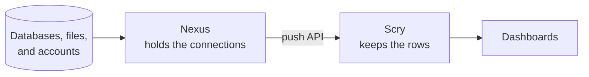

<div align="center">


# Nexus

**Connect your data once, and sync it into the apps that use it.**

[](https://github.com/PluperfectData/Nexus/actions/workflows/ci.yml)
[](https://github.com/PluperfectData/Nexus/actions/workflows/client.yml)
[](https://github.com/PluperfectData/Nexus/actions/workflows/docker.yml)

</div>

Nexus holds your data connections, such as databases, CSV files, and Charles Schwab accounts, and copies their tables
into the apps that use them, such as [Scry](https://github.com/PluperfectData/Scry). The apps never see a password or a
token: they ask Nexus for the data, and Nexus does the connecting. Nexus is open source, and it runs on your own
server.

Underneath is a connector library for .NET 10, which you can use on its own.

## Contents

- [What Nexus is for](#what-nexus-is-for)
- [Features](#features)
- [Connectors](#connectors)
- [Quick start](#quick-start)
- [Nexus and Scry](#nexus-and-scry)
- [The connector library](#the-connector-library)
- [Documentation](#documentation)
- [Contributing](#contributing)
- [Built with](#built-with)
- [License](#license)

## What Nexus is for

Every app that uses your data needs a way in: a database's password, an uploaded file, or a sign-in at a brokerage.
Nexus keeps those in one place. You connect each source once, in a workspace, and choose which of its tables go to
which app. Nexus copies them over, remembers where each copy stopped, and says in plain words when something goes
wrong.

For the people who build apps, Nexus means an app handles data, not connections. The app pairs with Nexus once, sends
its users to Nexus's connect page to link a source, and receives the rows through its own push API.

## Features

- **Connect once.** MySQL, PostgreSQL, and SQL Server databases, CSV files, and Charles Schwab accounts. Settings,
  passwords, and tokens are kept encrypted.
- **Pick the tables.** Each connection lists its tables, and each one you pick becomes a sync into an app.
- **Syncs that pick up where they stopped.** A full refresh replaces a table. An incremental sync reads only the rows
  past a cursor column, such as `updated_at`, and resumes from its last checkpoint. A failed run tries again after 1,
  5, and 15 minutes.
- **Sign in to providers in the browser.** A Schwab connection is made by signing in at Schwab. Each workspace signs in
  through its own app at the provider.
- **Sign-ins that end, said ahead of time.** Some providers end a sign-in on a clock, such as Schwab after 7 days.
  Nexus shows when, warns a day ahead in the Log and by mail to the people you pick, and signing in again early starts
  the clock over. A renewal into a different account is refused.
- **Pair an app with one approval.** An app asks to link, a Nexus admin approves it into a workspace, and no keys are
  copied by hand.
- **Connect pages.** An app sends a person to Nexus's connect page to link a source. They don't need a Nexus account,
  and the app never sees what they type.
- **Workspaces and members.** Admins invite people by mail and add them to workspaces. Members see and change their
  own workspaces' connections and syncs.
- **A log in plain words.** The Log page lists each run, with its rows or its error, and each change, with who made it.
- **Set up in the browser.** A first-run installer asks for the database, the address, mail, and the first admin. No
  configuration files, and no command line.

A sync runs when it's added or changed, and whenever someone, or an app, runs it. Scheduled syncs are planned, and so
are connectors for Google Sheets and Stripe.

## Connectors

| Connector | In the service | What it does |
|---|---|---|
| MySQL, PostgreSQL, and SQL Server | ✓ | Reads every table and view, whole or past a cursor column |
| CSV | ✓ | Reads an uploaded file, working out each column's type |
| Charles Schwab | ✓ | Reads balances, positions, transactions, orders, price history, quotes, and movers. In code, it also places, replaces, and cancels orders. |
| Push API | ✓ | Writes tables into an app, such as Scry, through the app's push API |
| DuckDB | | Writes tables into a DuckDB file |

Each connector has its own page in [the documentation](docs/connectors/README.md).

## Quick start

Nexus installs three ways. Each runs it on one computer, then sets it up in the browser, and each can set up
[Scry](https://github.com/PluperfectData/Scry) beside it. With the installer and in Docker, Nexus is at
`https://localhost:6165`, served over HTTPS with a certificate the computer is asked to trust once. From the command
line, it's at `http://localhost:6165`.

| Way | For | Needs |
|---|---|---|
| [With the installer](#with-the-installer) | Using Nexus on one computer | Windows 10 or 11, macOS, or Linux |
| [In Docker](#in-docker) | Running Nexus in containers, on any computer | Docker Desktop, or Docker on Linux |
| [From the command line](#from-the-command-line) | Working on Nexus's code | .NET 10, Node.js 24, MySQL 8.4, and Git |

All three use the same ports, so run one at a time.

Every way starts from the code at `Pluperfect.Data/Nexus` in a folder of your choice. Clone it with
`git clone https://github.com/PluperfectData/Nexus.git Pluperfect.Data/Nexus`, or download the ZIP from GitHub
and extract it there. Put Scry at `Pluperfect.Data/Scry` the same way to set them up together.

### With the installer

In the Nexus folder:

- **Windows 10 or 11:** right-click `install.ps1` and choose **Run with PowerShell**.
- **macOS or Linux:** run `bash install.sh` in a terminal.

It:

1. installs what's missing (.NET 10, Node.js, MySQL, Git, and Mailpit), through winget on Windows, Homebrew on a Mac,
   and downloads from their own sites on Linux, and fetches the two libraries Nexus builds against
2. asks whether to install Scry too, when it's beside Nexus
3. builds Nexus, and asks the computer once to trust the .NET development certificate, which serves Nexus's
   addresses, including `https://127.0.0.1:6164`, where providers such as Schwab send people back
4. adds a way to start Nexus again: a desktop shortcut on Windows, an app menu entry on Linux, and `sh start.sh` on
   macOS and Linux
5. starts Nexus with a database server of its own, and opens `https://localhost:6165`

The installer page opens at Mail, since Nexus already knows its database and addresses. Then make yourself the
admin. [Installing](docs/installing.md) has the detail.

### In Docker

Start Docker Desktop. On Linux, `sh nexus.sh` installs Docker Engine when it's missing. Then, in the Nexus folder:

- **Windows:** double-click `Nexus Docker.cmd`.
- **macOS or Linux:** run `sh nexus.sh`.

The launcher fetches the libraries Nexus builds against, and asks whether to start Scry too, linked to Nexus. Then
it builds and starts Nexus with MySQL beside it, and asks the computer once to trust the certificates Caddy makes for
Nexus's addresses. It prints the installer's address with its install code, and opens `https://localhost:6165`. The
first build takes several minutes. [Running Nexus in Docker](docs/docker.md) has the detail.

### From the command line

You'll run the Nexus service and its web client from their code, then set Nexus up in the browser.

#### What you need

- [.NET SDK 10](https://dotnet.microsoft.com/download/dotnet/10.0), version 10.0.302 or later
- [Node.js 24](https://nodejs.org/)
- [MySQL 8.4](https://dev.mysql.com/downloads/mysql/), with a user that can create Nexus's database
- [Git](https://git-scm.com/)
- [Mailpit](https://mailpit.axllent.org/), which shows the mail Nexus sends while you work on it

#### 1. Get the code

Nexus builds against two other repositories, which it expects to find beside it. Clone all three into one folder:

```bash
git clone https://github.com/PluperfectData/Nexus.git Pluperfect.Data/Nexus
git clone https://github.com/mnwachukwu/Pluperfect.Jwt.git
git clone https://github.com/mnwachukwu/Pluperfect.Mail.git
```

That gives you this layout. Every command below runs from the top folder.

```text
your-folder/
├── Pluperfect.Data/
│   └── Nexus/
├── Pluperfect.Jwt/
└── Pluperfect.Mail/
```

#### 2. Build the sign-in library

Nexus's client signs in through Pluperfect.Jwt's client, which is built once:

```bash
npm install --prefix Pluperfect.Jwt/client
npm run build --prefix Pluperfect.Jwt/client
```

#### 3. Start the service

Start Mailpit first, in a terminal of its own. It keeps the mail Nexus sends, and shows it at `http://localhost:8025`:

```bash
mailpit
```

Then, in another terminal, from the same folder:

```bash
dotnet dev-certs https
dotnet run --project Pluperfect.Data/Nexus/Server/src/Nexus.Service
```

The first line makes the .NET development certificate, if this machine has none yet. The service uses it for
`https://127.0.0.1:6164`, the address providers such as Schwab send people back to after they sign in. The service
itself listens on `http://localhost:6163`.

#### 4. Start the client

In a third terminal, from the same folder:

```bash
npm install --prefix Pluperfect.Data/Nexus/Client
npm run dev --prefix Pluperfect.Data/Nexus/Client
```

#### 5. Set it up

Open `http://localhost:6165/install`. The installer asks, in turn, for:

1. **Your database:** the MySQL server's address, a name for the database, and the user. Nexus makes the database and
   its tables.
2. **The address** people open Nexus at, already filled in for your machine.
3. **Mail**, already going to Mailpit, so the first admin may skip the password. Choose Postmark here to send real
   mail.
4. **The first admin:** your email, and a password if you want one.
5. **The callback address** providers send people back to after they sign in, already filled in for your machine.

Then make a workspace and add a connection. To send its tables somewhere, run [Scry](https://github.com/PluperfectData/Scry)
beside it, and link the two from a Scry workspace's Settings page. [Running Nexus](docs/running.md) covers the
installer in full, including setting up an instance from another machine.

## Nexus and Scry

Nexus fetches your data, and [Scry](https://github.com/PluperfectData/Scry) shows it. Nexus holds the connections and
copies their tables into Scry through Scry's push API, and Scry turns them into dashboards.



Scry is one such app, and any app with a push API can do the same.
[Apps and connect pages](docs/apps-and-connect-pages.md) covers pairing and the connect page, and
[Push API](docs/connectors/push.md) covers the calls Nexus makes to an app.

## The connector library

Every connector is also a .NET 10 library, which you can use without the service. A source reads streams of records, a
destination writes them, and an action changes something on a service, such as placing an order. A source runs on its
own with the records in memory, or piped into a destination.

```csharp
var result = await source.ReadToMemoryAsync(
    config,
    new ReadRequest([new StreamSelection("orders", SyncMode.FullRefresh)]),
    logger);

MemoryTable orders = result.Tables["orders"];
```

Each connector is a project under `Server/src`, and each tagged release attaches them to its GitHub release as NuGet
packages. [Using the connectors in code](docs/connectors/usage.md) has more examples, and
[the connector contract](docs/connectors/contract.md) covers what every connector shares.

## Documentation

The [documentation](docs/README.md) covers each part in depth, with a contents page to find your way around. Good
places to start:

- [Installing](docs/installing.md) and [Running Nexus in Docker](docs/docker.md): the other two ways in
- [Running Nexus](docs/running.md): the installer, and setting up an instance from another machine
- [Apps and connect pages](docs/apps-and-connect-pages.md): linking an app, and connecting a source from one
- [Connectors](docs/connectors/README.md): what each connector reads or writes, and its settings
- [Configuration](docs/configuration.md): every setting, for the people who run an instance

## Contributing

Contributions are welcome. In short:

1. For anything bigger than a small fix, open an issue first, so we can agree on the approach.
2. Fork the repository, and make a branch named for your change.
3. Open a pull request into `main`. CI must pass, and a maintainer reviews it.
4. Pull requests are squash-merged, so each becomes one commit on `main`.

To run the code while you work on it, start it [from the command line](docs/running.md), or in Docker, in the
-dev containers that `Nexus Dev.cmd` or `nexus-dev.sh` starts, which reload on each save: [In Docker, with the -dev
containers](docs/running.md#in-docker-with-the--dev-containers).

Contributing comes with terms: by contributing, you give the maintainer permission to relicense your contribution.
Read [CONTRIBUTING.md](CONTRIBUTING.md) before you start.

## Built with

Nexus is a .NET 10 service and a React 19 client, built with Vite. It keeps its users, workspaces, connections, and
syncs in MySQL. Thank you to the authors of the open-source packages below.

Nexus also builds on two libraries of our own, checked out beside it:
[Pluperfect.Jwt](https://github.com/mnwachukwu/Pluperfect.Jwt) for sessions, and
[Pluperfect.Mail](https://github.com/mnwachukwu/Pluperfect.Mail) for mail. Each lists the packages it uses, and their
licenses, in its own README.

### The connectors (`Server/src`)

| Package | Project | Used for | License |
|---|---|---|---|
| [Microsoft.Extensions.Logging.Abstractions](https://www.nuget.org/packages/Microsoft.Extensions.Logging.Abstractions) | `Nexus.Abstractions` | A connector's log lines | [MIT](https://spdx.org/licenses/MIT.html) |
| [Sylvan.Data.Csv](https://www.nuget.org/packages/Sylvan.Data.Csv) | `Nexus.Csv` | Reading CSV files | [MIT](https://spdx.org/licenses/MIT.html) |
| [DuckDB.NET.Data.Full](https://www.nuget.org/packages/DuckDB.NET.Data.Full) | `Nexus.DuckDb` | Writing DuckDB files | [MIT](https://spdx.org/licenses/MIT.html) |
| [MySqlConnector](https://www.nuget.org/packages/MySqlConnector) | `Nexus.MySql` | Reading MySQL | [MIT](https://spdx.org/licenses/MIT.html) |
| [Npgsql](https://www.nuget.org/packages/Npgsql) | `Nexus.Postgres` | Reading PostgreSQL | [PostgreSQL](https://spdx.org/licenses/PostgreSQL.html) |
| [Microsoft.Data.SqlClient](https://www.nuget.org/packages/Microsoft.Data.SqlClient) | `Nexus.SqlServer` | Reading SQL Server | [MIT](https://spdx.org/licenses/MIT.html) |

### The service (`Server/src/Nexus.Service`)

| Package | Used for | License |
|---|---|---|
| [Microsoft.EntityFrameworkCore](https://www.nuget.org/packages/Microsoft.EntityFrameworkCore) | The service's own records | [MIT](https://spdx.org/licenses/MIT.html) |
| [Microsoft.EntityFrameworkCore.Relational](https://www.nuget.org/packages/Microsoft.EntityFrameworkCore.Relational) | Migrations, and EF Core's relational parts | [MIT](https://spdx.org/licenses/MIT.html) |
| [Microsoft.EntityFrameworkCore.Design](https://www.nuget.org/packages/Microsoft.EntityFrameworkCore.Design) | Making migrations | [MIT](https://spdx.org/licenses/MIT.html) |
| [Pomelo.EntityFrameworkCore.MySql](https://www.nuget.org/packages/Pomelo.EntityFrameworkCore.MySql) | EF Core's MySQL provider | [MIT](https://spdx.org/licenses/MIT.html) |
| [Serilog.AspNetCore](https://www.nuget.org/packages/Serilog.AspNetCore) | The developer log | [Apache-2.0](https://spdx.org/licenses/Apache-2.0.html) |

### The tests (`Server/tests`)

| Package | Used for | License |
|---|---|---|
| [Microsoft.AspNetCore.Mvc.Testing](https://www.nuget.org/packages/Microsoft.AspNetCore.Mvc.Testing) | Hosting the service in a test | [MIT](https://spdx.org/licenses/MIT.html) |
| [Microsoft.EntityFrameworkCore.Sqlite](https://www.nuget.org/packages/Microsoft.EntityFrameworkCore.Sqlite) | A SQLite database for the service's tests | [MIT](https://spdx.org/licenses/MIT.html) |
| [Microsoft.NET.Test.Sdk](https://www.nuget.org/packages/Microsoft.NET.Test.Sdk) | Running the tests | [MIT](https://spdx.org/licenses/MIT.html) |
| [NUnit](https://www.nuget.org/packages/NUnit) | The test framework | [MIT](https://spdx.org/licenses/MIT.html) |
| [NUnit3TestAdapter](https://www.nuget.org/packages/NUnit3TestAdapter) | Running NUnit tests through `dotnet test` | [MIT](https://spdx.org/licenses/MIT.html) |
| [NUnit.Analyzers](https://www.nuget.org/packages/NUnit.Analyzers) | Catching test mistakes at build time | [MIT](https://spdx.org/licenses/MIT.html) |
| [Shouldly](https://www.nuget.org/packages/Shouldly) | Assertions | [BSD-3-Clause](https://spdx.org/licenses/BSD-3-Clause.html) |

### The client (`Client`)

| Package | Used for | License |
|---|---|---|
| [React](https://www.npmjs.com/package/react) (`react`) | The pages | [MIT](https://spdx.org/licenses/MIT.html) |
| [react-dom](https://www.npmjs.com/package/react-dom) | Drawing the pages in the browser | [MIT](https://spdx.org/licenses/MIT.html) |
| [React Router](https://www.npmjs.com/package/react-router) (`react-router`) | Moving between pages | [MIT](https://spdx.org/licenses/MIT.html) |

<details>
<summary>The client's development tools</summary>

| Package | Used for | License |
|---|---|---|
| [Vite](https://www.npmjs.com/package/vite) (`vite`), [@vitejs/plugin-react](https://www.npmjs.com/package/@vitejs/plugin-react) | Building the client, and serving it while you work | [MIT](https://spdx.org/licenses/MIT.html) |
| [TypeScript](https://www.npmjs.com/package/typescript) (`typescript`) | Checking types | [Apache-2.0](https://spdx.org/licenses/Apache-2.0.html) |
| [oxlint](https://www.npmjs.com/package/oxlint) | Linting | [MIT](https://spdx.org/licenses/MIT.html) |
| [Jest](https://www.npmjs.com/package/jest) (`jest`), [jest-environment-jsdom](https://www.npmjs.com/package/jest-environment-jsdom), [babel-jest](https://www.npmjs.com/package/babel-jest) | Unit tests, in a simulated browser | [MIT](https://spdx.org/licenses/MIT.html) |
| [@babel/core](https://www.npmjs.com/package/@babel/core), [@babel/preset-env](https://www.npmjs.com/package/@babel/preset-env), [@babel/preset-react](https://www.npmjs.com/package/@babel/preset-react), [@babel/preset-typescript](https://www.npmjs.com/package/@babel/preset-typescript), [babel-plugin-transform-vite-meta-env](https://www.npmjs.com/package/babel-plugin-transform-vite-meta-env) | Compiling the client for Jest | [MIT](https://spdx.org/licenses/MIT.html) |
| [@testing-library/dom](https://www.npmjs.com/package/@testing-library/dom), [@testing-library/jest-dom](https://www.npmjs.com/package/@testing-library/jest-dom), [@testing-library/react](https://www.npmjs.com/package/@testing-library/react), [@testing-library/user-event](https://www.npmjs.com/package/@testing-library/user-event) | Rendering a page in a test, and using it as a person would | [MIT](https://spdx.org/licenses/MIT.html) |
| [identity-obj-proxy](https://www.npmjs.com/package/identity-obj-proxy) | Standing in for stylesheets in tests | [MIT](https://spdx.org/licenses/MIT.html) |
| [@types/jest](https://www.npmjs.com/package/@types/jest), [@types/node](https://www.npmjs.com/package/@types/node), [@types/react](https://www.npmjs.com/package/@types/react), [@types/react-dom](https://www.npmjs.com/package/@types/react-dom) | Types for TypeScript | [MIT](https://spdx.org/licenses/MIT.html) |

</details>

## License

Nexus is free software, under the [GNU Affero General Public License, version 3 only](LICENSE). You may use it, change
it, and share it, as long as what you share stays under the same license, with its source code. If you run a changed
Nexus that other people use over a network, you must offer them its source code too.

Contributions come with terms of their own, set out in [CONTRIBUTING.md](CONTRIBUTING.md#contributor-terms).
